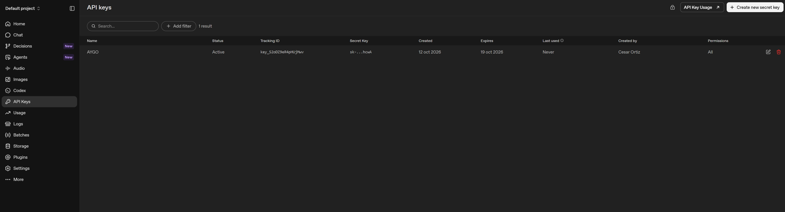
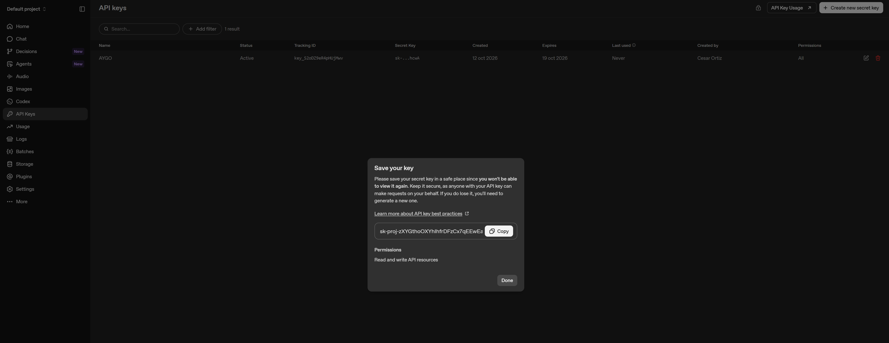
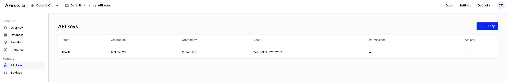
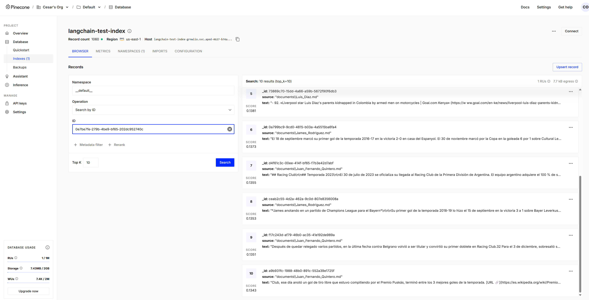
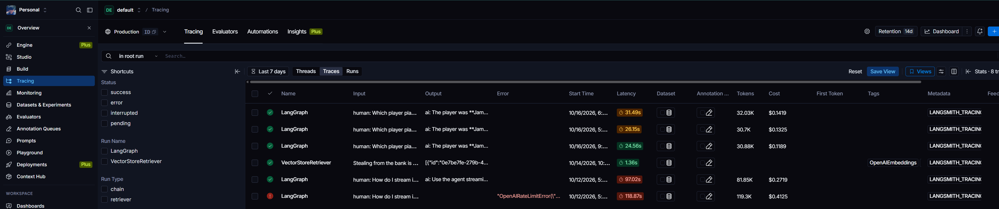
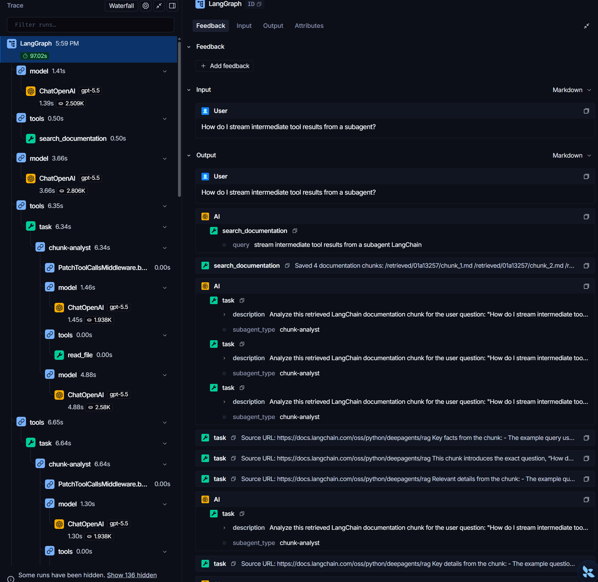

# Taller RAG: Sistema de Búsqueda y Preguntas/Respuestas sobre Futbolistas Colombianos


## Autor: Cesar Fernando Ortiz Rocha

---

Este proyecto implementa una arquitectura completa de **Retrieval-Augmented Generation (RAG)** de nivel producción utilizando **LangChain**, modelos de lenguaje de **OpenAI**, una base de datos vectorial en la nube con **Pinecone** y un agente multi-agente para la consulta e interpretación de información sobre futbolistas colombianos (*James Rodríguez*, *Juan Fernando Quintero* y *Luis Díaz*).

---

## 🛠️ Requisitos Previos e Instalación

### 1. Requisitos del Entorno
* Python 3.11 (se recomienda utilizar un entorno virtual).
* Una cuenta en OpenAI con una API Key activa.
* Una cuenta en Pinecone con un índice configurado.

Para esto debes buscar OpenAI api key, registrarte con un correo y solicitar una API key en el siguiente menu 



Ademas de crearte una cuenta en pipecone, cuando se cree la cuenta se proporcionara una api key por defecto.


### 2. Creación del Entorno Virtual e Instalación de Dependencias

Ejecutar los siguientes comandos en la consola

```cmd
# Crear entorno virtual con Python 3.11
py -3.11 -m venv langchain_env

# Activar el entorno virtual (Windows)
langchain_env\Scripts\activate

# Instalar las librerías necesarias
pip install langchain openai jupyter
pip install deepagents "langchain[openai]" langchain-text-splitters requests numpy
pip install -U "langchain-openai"
pip install -U "langchain-core"
pip install -qU langchain langchain-pinecone langchain-openai

# Abrir Jupyter notebook
jupyter notebook

```

---

## 🚀 Configuración de Variables de Entorno

Antes de ejecutar el Jupyter Notebook, asegúrate de configurar las claves de API necesarias:

```python
import os

os.environ["OPENAI_API_KEY"] = "tu-openai-api-key"
os.environ["PINECONE_API_KEY"] = "tu-pinecone-api-key"

```

---

## 🏗️ Arquitectura del Sistema RAG

El flujo de trabajo implementado en este proyecto sigue estos pasos principales:

1. **Carga de Documentos Locales (`Document Loading`):**
* Se leen archivos locales en formato Markdown (`.md`) ubicados dentro de la carpeta local `./documents/`.
* Los documentos contienen trayectorias biográficas y datos estadísticos de jugadores de fútbol colombianos.


2. **Procesamiento y Fragmentación (`Text Splitting`):**
* Se utiliza `RecursiveCharacterTextSplitter` con un `chunk_size` de 1000 caracteres y un `chunk_overlap` de 200 para preservar el contexto de las oraciones.


3. **Indexación y Embeddings Vectoriales:**
* Se convierten los fragmentos en embeddings vectoriales utilizando el modelo `text-embedding-3-small` de OpenAI (o bien `text-embedding-3-large`).
* Los vectores generados se almacenan y persisten de forma remota en la base de datos vectorial **Pinecone** utilizando un índice con dimensión de 1536.


1. **Agente Autónomo y Búsqueda (`Retrieval & Subagents`):**
* **Búsqueda por Similitud:** La herramienta `search_documentation` consulta el índice de Pinecone y extrae los fragmentos más relevantes.
* **Delegación a Subagentes:** El agente orquestador guarda los fragmentos recuperados en el sistema de archivos del agente y delega el análisis individual de cada fragmento al subagente `chunk-analyst`.
* **Síntesis Final:** Se combinan los análisis concisos generados por los subagentes para devolver una respuesta estructurada con fuentes citadas al usuario.


---

## 📊 Comparativa de Rendimiento: Memory VectorStore vs. Pinecone

| Criterio | Almacenamiento en Memoria (`InMemoryVectorStore`) | Almacenamiento en la Nube (`PineconeVectorStore`) |
| --- | --- | --- |
| **Persistencia de Datos** | Temporal. Los embeddings se pierden al reiniciar o cerrar el kernel de Python. | Permanente. Los datos quedan guardados y disponibles en la nube de Pinecone. |
| **Escalabilidad** | Limitada por la memoria RAM de la máquina local. | Alta. Permite buscar sobre millones de vectores de forma rápida y distribuida. |
| **Casos de Uso** | Pruebas de concepto, desarrollo local rápido y pruebas unitarias. | Ambientes de producción, aplicaciones multiusuario y sistemas RAG enterprise. |

---

## 📁 Estructura del Proyecto

```text
.
├── documents/                       # Carpeta con los documentos base (.md)
│   ├── James_Rodriguez.md
│   ├── Juan_Fernando_Quintero.md
│   └── Luis_Diaz.md
├── RAG_TEST.ipynb                   # Jupyter Notebook principal con la implementación RAG y Pinecone
├── README.md                        # Documentación general del proyecto
└── langchain_env/                   # Entorno virtual de Python

```

---

## 🧪 Ejemplo de Uso

Una vez ejecutadas todas las celdas del notebook, puedes realizar consultas de prueba como:

```python
EXAMPLE_QUERY = "Which player played for Real Madrid, and at what age?"

result = agent.invoke({"messages": [HumanMessage(content=EXAMPLE_QUERY)]})

for msg in result.get("messages", []):
  if msg.text:
    print(msg.text)

```

## Resultados de las Ejecuciones en LangSmitch

